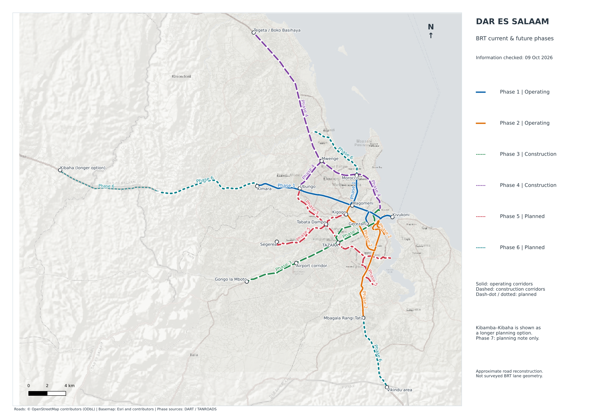

# Dar es Salaam BRT QGIS project

Current and future Dar es Salaam Bus Rapid Transit phases, with an information snapshot of **9 October 2026**.

## Download and open

[Download the complete QGIS project ZIP](Dar_BRT_QGIS_Current_and_Future_Phases.zip)

1. Download and extract the entire ZIP.
2. Open `Dar_BRT_QGIS/Dar_BRT_All_Phases.qgz` for the regional view, or `Dar_BRT_QGIS/Dar_BRT_City_Detail.qgz` for the city view.
3. Keep the `data` folder beside the project files. Offline background maps are included.

Requires QGIS 3.34 or newer. You can also clone/download this repository and open either project directly.

## Network overview

[City detail preview](Dar_BRT_QGIS/Dar_BRT_City_Detail.png)

## Included

- Two QGIS projects with phase colours, labels, bookmarks and map layouts.
- Editable GeoPackage, corridor GeoJSON and individual phase styles.
- Offline regional and city background maps.
- Phase summary and source references.

Phases 1–2 are shown as operating, 3–4 as construction/commissioning, and 5–6 as future phases. Phase 7 is recorded only as a planning note because no fixed alignment was identified.

**The lines are approximate corridor reconstructions, not official engineering alignments or passenger service routes.** Phase 6 alternatives and indicative connectors are documented in the [full project guide](Dar_BRT_QGIS/README.md). Read that guide before using or editing the data.

## Sources and attribution

Status and corridor descriptions use DART, TANROADS and dated reporting. See [source references](Dar_BRT_QGIS/sources.csv) and the [full guide](Dar_BRT_QGIS/README.md) for source dates, differences and limitations.

Road geometry: © OpenStreetMap contributors, [ODbL 1.0](https://www.openstreetmap.org/copyright). Background maps: Esri World Street Map and its contributors, [service information](https://server.arcgisonline.com/ArcGIS/rest/services/World_Street_Map/MapServer).

This is an independent reference project, not an official DART publication. Underlying sources retain their respective attribution and licence requirements.
